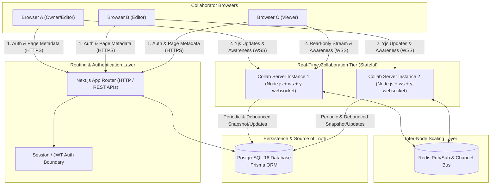
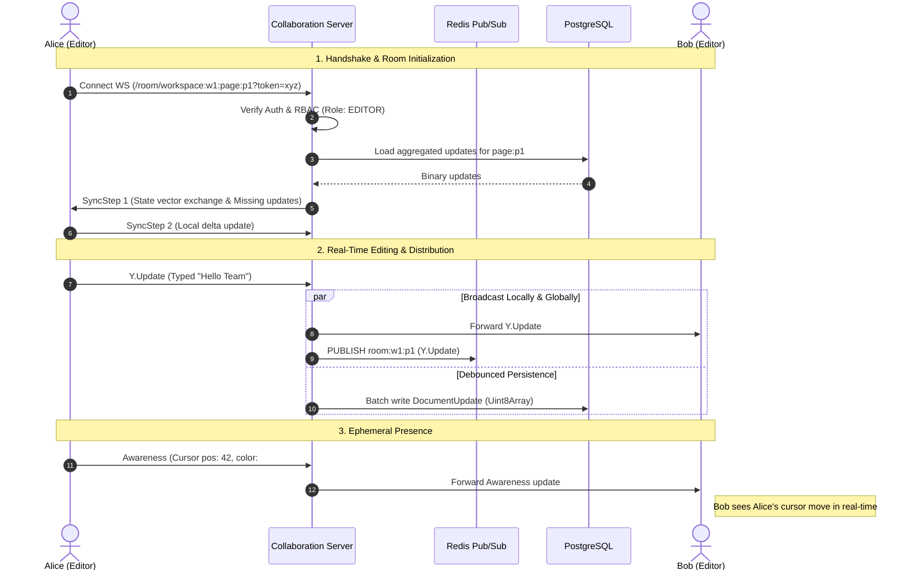

# RealCollab — Architecture & Technical Blueprint

## 1. System Overview

**RealCollab** is a real-time collaborative workspace designed as a hybrid of Notion's document modularity and Figma's multiplayer collaboration layer. It uses Conflict-free Replicated Data Types (CRDTs via **Yjs**) to guarantee strong eventual consistency across multiple concurrent editors without lock contention or data loss.



---

## 2. Fundamental Architectural Decision: Modular Monorepo

We keep the **Next.js Web application** and the **Collaboration WebSocket Server** logically and process-wise separated:

1. **`apps/web` (Next.js 14/15 App Router)**:
   - Server-Side Rendering (SSR) and Client UI.
   - Authentication, User profiles, Workspace CRUD, Pages hierarchy, Comments, and Role-Based Access Control (RBAC).
   - Designed to run seamlessly in standard stateless/serverless environments.

2. **`apps/collaboration-server` (Node.js + `ws` + `y-websocket`)**:
   - Long-lived, stateful WebSocket daemon.
   - Maintains in-memory `Y.Doc` instances per active document room.
   - Emits and listens to Redis Pub/Sub channels to sync across multiple server instances.
   - Batches and persists binary Yjs document updates directly into PostgreSQL.

3. **`packages/shared`**:
   - Shared Prisma schema, generated client, TypeScript interfaces, RBAC permission definitions, and validation logic.

---

## 3. CRDTs and State Synchronization Model

### 3.1 Understanding Yjs Core Concepts
| Concept | Definition & Role |
| :--- | :--- |
| **CRDT** | Conflict-free Replicated Data Type. Mathematical structure enabling concurrent modifications across distributed nodes that provably converge to identical state without a central coordinator. |
| **Y.Doc** | The root container of shared collaborative state holding shared types (`Y.Text`, `Y.Map`, `Y.Array`, `Y.XmlFragment`). |
| **State Vector** | Compact vector clock representation summarizing all client clocks/operations known to a local document. Used during handshake to compute missing deltas. |
| **Y.Update** | Binary payload (`Uint8Array`) containing incremental operations (insertions, deletions, attributes) formatted via lib0 encoding. |
| **Awareness** | **Ephemeral** protocol layer for volatile presence data (cursor coordinates, active selection, user display name, avatar, and color). **Never persisted to the database.** |

### 3.2 Dual Data Flow: Updates vs. Awareness



---

## 4. Room Naming & Strict Authorization

Rooms follow a deterministic, secure naming convention:
```
workspace:{workspaceId}:page:{pageId}
```

### Authorization Rules:
1. **Token Validation**: On connection upgrade, the server parses the authentication token/cookie.
2. **Membership Check**: The user must be an active member of `workspaceId`.
3. **Role Enforcement**:
   - `OWNER` / `EDITOR`: Can receive and transmit `Y.Update` and `Awareness`.
   - `COMMENTER` / `VIEWER`: Connected in **read-only mode**. If a viewer sends a `Y.Update` frame, the connection drops or rejects the frame with a policy error code.
4. **Origin Validation**: WebSocket server rejects unauthorized origins in production.

---

## 5. Persistence & Recovery Strategy

1. **Incremental Updates**:
   - Document modifications are queued in memory and flushed via debounced batch writes (`DocumentUpdate` model) to avoid excessive database writes on every keystroke.
2. **Periodic Snapshots**:
   - Periodically (or upon explicit user save/tagging), all pending updates are merged into a unified document state via `Y.encodeStateAsUpdate(ydoc)` and saved as a `DocumentSnapshot`.
   - Older incremental update rows before the snapshot can be pruned or compacted.
3. **Disaster Recovery**:
   - If the collaboration server crashes, the newly spun-up instance loads the latest snapshot and replays subsequent updates from PostgreSQL.

---

## 6. Horizontal Scaling with Redis Pub/Sub

When scaling across $N$ collaboration server nodes behind a load balancer:
- Each server subscribes to `room:${roomId}` on Redis when the first local client connects.
- Outgoing document updates from local clients are published to `room:${roomId}`.
- Updates received from Redis are forwarded to all local clients in that room except the origin sender.
- When the last client disconnects from a room on a given node, the node unsubscribes from Redis.
