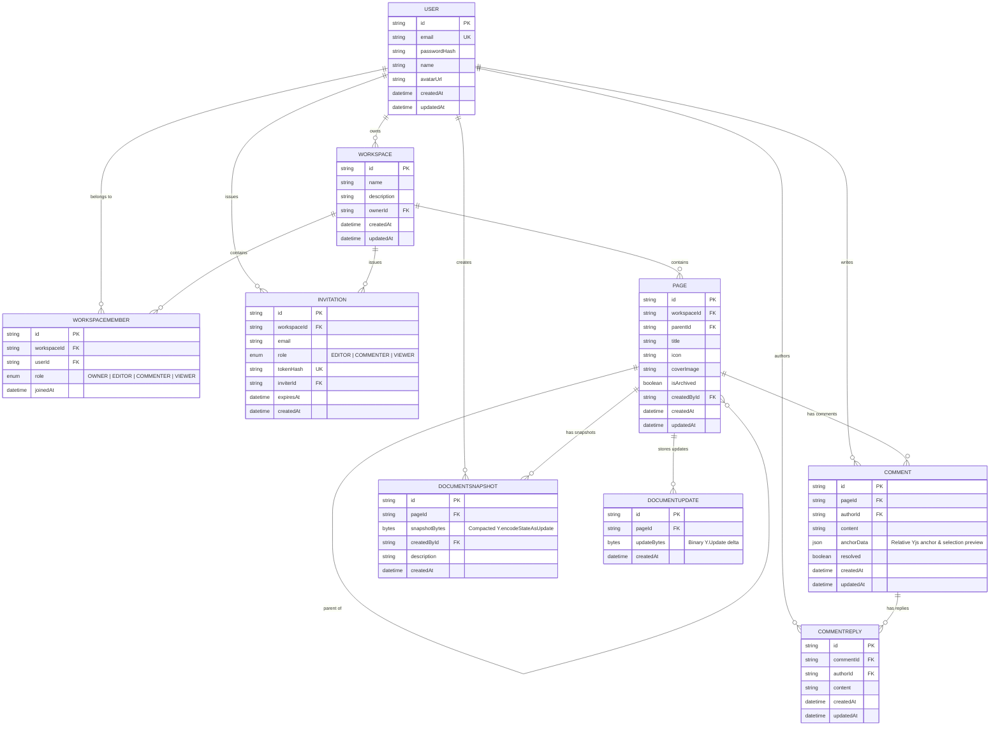

# RealCollab — Database Schema & Data Modeling

## 1. Entity-Relationship Overview



---

## 2. Models & Field Specifications

### 2.1 User
Represents authenticated identities.
- `id`: CUID or UUID string.
- `email`: Normalized unique email address.
- `passwordHash`: Argon2id or bcrypt hash (never plaintext).
- `name`: Display name.
- `avatarUrl`: Optional link to user avatar.
- `createdAt` / `updatedAt`: Standard audit timestamps.

### 2.2 Workspace & WorkspaceMember
Provides organizational tenant boundary.
- A user can own multiple workspaces and belong to many workspaces.
- Roles are strictly per-workspace (`OWNER`, `EDITOR`, `COMMENTER`, `VIEWER`).
- Unique compound constraint on `(workspaceId, userId)`.

### 2.3 Page
Hierarchical document node in a workspace.
- `parentId`: Nullable self-reference allowing nested sub-pages.
- `workspaceId`: Foreign key to `Workspace` (cascades on delete).
- `title`: Page header title (default: "Untitled").
- `isArchived`: Soft-delete flag.

### 2.4 DocumentUpdate & DocumentSnapshot (Yjs CRDT Storage)
- **`DocumentUpdate`**: Stores incremental binary operations (`Bytes`).
  - Inserted by the collaboration server in debounced batches.
  - Indexed by `pageId` and `createdAt` for fast chronological replay.
- **`DocumentSnapshot`**: Compacted historical checkpoints.
  - Contains complete document state encoded via `Y.encodeStateAsUpdate(ydoc)`.
  - Enables version preview, rollback, and pruning of historic individual updates.

### 2.5 Comment & CommentReply
Threaded discussions attached to documents.
- `anchorData`: Stored as JSON with Yjs RelativePosition representation (`{ from: ..., to: ..., quote: "..." }`).
- `resolved`: Boolean flag for thread closure.
- `CommentReply`: Threaded responses ordered chronologically.

### 2.6 Invitation
Time-bounded workspace invite tokens.
- Securely hashed tokens (`tokenHash`).
- Automatic expiration checking (`expiresAt`).

---

## 3. Indexes & Performance Optimization

```prisma
// Sample indexing strategy in schema.prisma:
@@index([workspaceId])
@@index([pageId, createdAt])
@@index([email])
@@unique([workspaceId, userId])
```
1. Fast lookups of all pages for a workspace.
2. Fast sequential loading of binary document updates for a page room.
3. Fast membership role queries upon WebSocket handshake.
